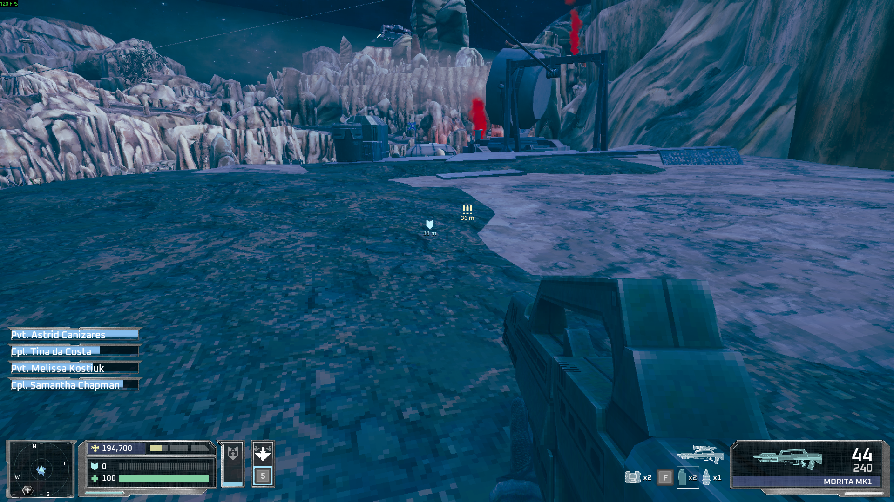
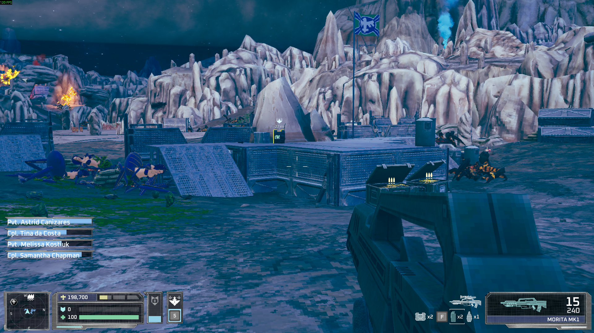

# Supply Tracker

Find nearby ammo, armour, health, grenades and supplies with clear icons and distance markers in **Starship Troopers: Ultimate Bug War!**

- Supplies and ammo/armour crates appear more than **10 metres** away, up to **60 metres**. Markers hide when you get close.
- Weapons show their icon, name and distance within **10 metres**.
- Empty ammo and armour crates stop showing markers.
- Up to five compact markers at once. No background boxes or item descriptions on general supplies.
- Display only: does not change inventory, damage, pickup amounts or saves.

## Easy installation

1. Download **[Supply-Tracker-1.0.0-Setup.exe](https://github.com/NEXara/Starship-Troopers-Supply-Tracker/releases/download/v1.0.0/Supply-Tracker-1.0.0-Setup.exe)**.
2. Close the game and run the installer.
3. Select the main game folder containing `StarshipTroopers_UBW.exe`, then click **Install / Update**.
4. Start the game and enter a mission.

The installer includes the required UE4SS loader. English is the default; optional Thai labels and installer interface are available with **EN / ไทย**. Use the same installer and **Uninstall** to remove the mod. Shared UE4SS files are retained if other mods need them.

Example folder: `N:\SteamLibrary\steamapps\common\StarshipTroopers_UltimateBugWar`. Your drive may differ. In Steam, **Manage → Browse local files** opens the correct folder.

Requires Windows 10/11, .NET Framework 4.8 and Steam build **22832378**. Tested with UE4SS **v4.0.0-6-gef15eba8**, at 1920×1080. Other resolutions may need configuration adjustments.

## Configuration

Close the game and edit `ue4ss/Mods/NearbySupplies/Scripts/config.lua` to change range, marker count or UI scale. Markers use straight-line 3D distance and can be visible through walls; they do not show a walking route.

## Other mods visible in the screenshots

The squad names and health bars on the left are from **[Squad Status HUD](https://www.nexusmods.com/starshiptroopersultimatebugwar/mods/15)**, a separate optional mod. Its [easy installer is on GitHub](https://github.com/NEXara/Starship-Troopers-Squad-Status-HUD/releases/latest).

The modified insect characters are **experimental model tests**. They are not included and are **not available to download**, because they do not work well enough yet.

## Credits

Made with AI, with user testing and feedback. UE4SS by the UE4SS-RE team and contributors (MIT); its license is included with the bundled loader. Original game content belongs to its owners. Icons and the game font are loaded from the installed game and are not redistributed as mod assets. Independent community mod, not affiliated with the game's creators.

**1.0.0 · 23 November 2026.** Approved in-game by the user from the 0.1.2 candidate. The official release preserves its accepted gameplay/display settings.
